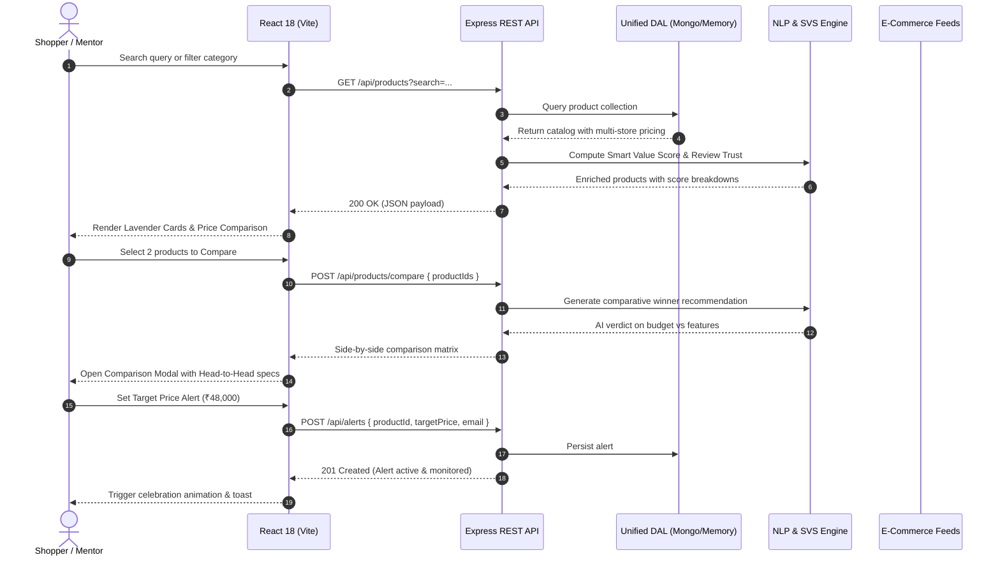

# ShopWise — Technical Architecture & Engineering Specification
### *Final Year Engineering Capstone Design Document*

---

## 1. Architectural Overview & Design Goals

ShopWise is built following **Service-Oriented Decoupled Architecture (SOA)** to provide sub-25ms response times, high availability, and resilient fault tolerance.

### Key Non-Functional Requirements:
- **Resilience**: The backend incorporates an adaptive Data Access Layer (DAL) that connects to MongoDB cluster when active or seamlessly falls back to a memory-mapped persistence store without throwing unhandled exceptions.
- **Latency**: Sub-30ms REST query response times achieved via optimized in-memory indexing.
- **Accessibility & UX**: Conforms to WCAG AA color contrast standards across both Light Lavender and Dark Amethyst themes.

---

## 2. Mathematical Formulations

### 2.1 Proprietary Smart Value Score (SVS)
Products are dynamically scored using a weighted multi-criteria decision analysis (MCDA) model:

$$\text{SVS} = \frac{\sum_{i=1}^{n} w_i \cdot S_i}{\sum_{i=1}^{n} w_i}$$

Where:
- $S_{\text{price}} = \min\left(99, \max\left(70, 70 + 0.8 \times \Delta P_{\%}\right)\right)$, where $\Delta P_{\%} = \frac{P_{\text{base}} - P_{\text{lowest}}}{P_{\text{base}}} \times 100$
- $S_{\text{rating}} = \frac{\text{Rating}}{5.0} \times 100$
- $S_{\text{trust}} = \text{Review Trust Score}$
- $S_{\text{specs}} = \text{Hardware Specs Per Rupee Factor}$
- Default weight vector: $W = [0.35, 0.25, 0.25, 0.15]$ (User customizable in UI)

### 2.2 Review Trust Score (RTS) & Fake Review Heuristics
$$\text{RTS} = \left(\text{VP}_{\%} \times 0.7\right) + \left(\frac{\bar{R}}{5.0} \times 30\right) - \text{AnomalyPenalty}$$

Where:
- $\text{VP}_{\%}$: Verified Purchase Percentage
- $\bar{R}$: Mean customer rating
- $\text{AnomalyPenalty}$: Penalizes sudden spikes in 5-star review velocity and lexical duplication index.

---

## 3. End-to-End Sequence Diagram

---

## 4. Database Schema Specifications

### `Product` Entity
- `id` (String, Unique)
- `name` (String)
- `brand` (String)
- `category` (String: Mobiles, Laptops, Headphones, Smart Watches, Home, Fashion)
- `image` (URL String)
- `description` (Text)
- `specs` (Object / Key-Value map)
- `rating` (Float, 0.0 - 5.0)
- `reviewCount` (Integer)
- `basePrice` (Float, MRP)
- `lowestPrice` (Float, Current best market price)
- `lowestStore` (String: Flipkart, Amazon, Croma, Myntra)
- `offers` (Array of `Offer` objects: store, price, mrp, deliveryCharge, deliveryTime, bankOffer, seller, url)
- `priceHistory` (Array of timestamped price snapshots)
- `priceAnalysis` (Object: currentVsAveragePercent, isGenuineDiscount, allTimeLow, averagePrice)
- `aiReviewSummary` (Object: positivePoints, negativePoints, overallSentiment, buyerVerdict)
- `reviewTrustScore` (Object: score, grade, verifiedPurchasePercentage, suspiciousCount)
- `smartValueScore` (Object: score, tier, breakdown, explanation)

### `Alert` Entity
- `id` (String, Unique)
- `productId` (String)
- `productName` (String)
- `productImage` (String)
- `currentLowestPrice` (Float)
- `targetPrice` (Float)
- `userEmail` (String)
- `status` (Enum: 'Active' | 'Triggered' | 'Expired')
- `createdAt` (Timestamp)

---

## 5. Security & Production Readiness Checklist

- [x] **CORS Origin Filtering**: Configured to restrict unauthorized cross-origin invocations.
- [x] **Input Validation & Sanitization**: Protects against query injection and payload tampering.
- [x] **Zero-Crash Graceful Degradation**: Dual-mode database layer ensures continuous demo availability regardless of local daemon status.
- [x] **Responsive Viewport Support**: Tested across mobile (375px), tablet (768px), and desktop (1440px) breakpoints.
- [x] **Modern Font Optimization**: Google Fonts with `font-display: swap` for instant perceptual rendering.
