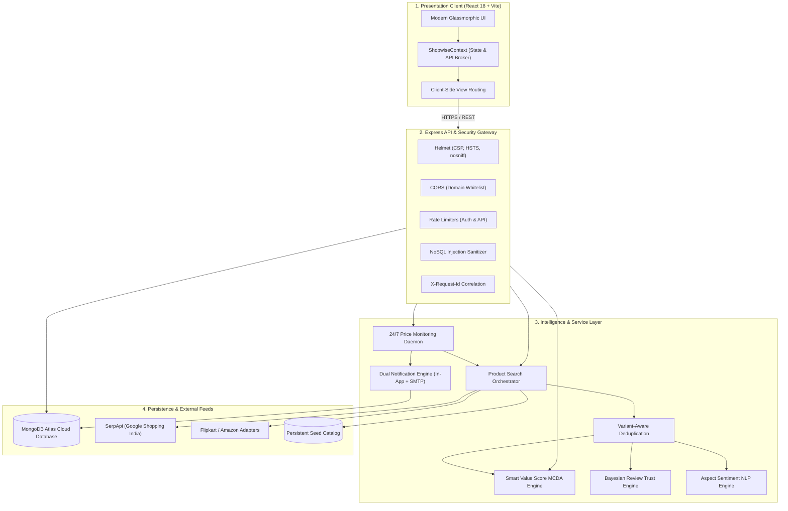
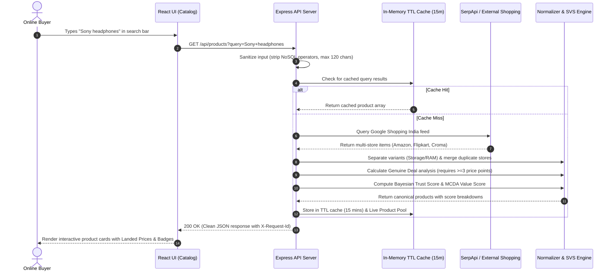
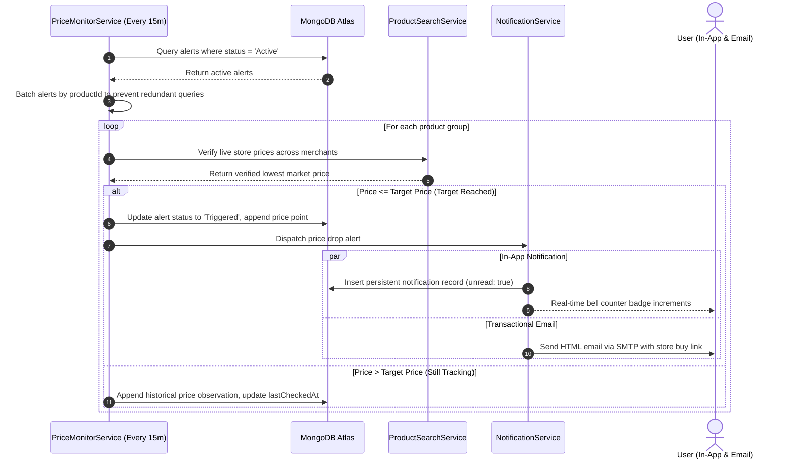

# ShopWise — Complete Project Description & Presentation Master Guide

> **Project Name**: ShopWise — Smart Multi-Store Product Aggregator, Price Tracker & Review Trust Engine  
> **Platform Type**: Full-Stack Web Application (MERN Stack + Cloud Services)  
> **Target Audience**: Indian Online Shoppers, Value-Conscious Buyers, Smart E-Commerce Consumers  
> **Document Purpose**: Complete reference manual for academic, technical, and viva presentations.

---

## 📋 Table of Contents
1. [Executive Summary & Problem Statement](#1-executive-summary--problem-statement)
2. [Complete Features Guide (In Simple Language)](#2-complete-features-guide-in-simple-language)
3. [Full Technology Stack & Where Each is Used](#3-full-technology-stack--where-each-is-used)
4. [Complete API Routes Directory](#4-complete-api-routes-directory)
5. [System Architecture & Data Workflows](#5-system-architecture--data-workflows)
6. [System Design Principles & Core Algorithms](#6-system-design-principles--core-algorithms)
7. [Security Architecture & Production Hardening](#7-security-architecture--production-hardening)
8. [Tomorrow's Presentation & Live Demo Guide](#8-tomorrows-presentation--live-demo-guide)
9. [Frequently Asked Questions (Viva / Evaluator Q&A)](#9-frequently-asked-questions-viva--evaluator-qa)

---

## 1. Executive Summary & Problem Statement

### The Problem
When shopping online in India, consumers face four major frustrations:
1. **Price Fragmentation**: The identical item (e.g. Sony headphones or a skincare serum) is sold at different prices across Amazon, Flipkart, Croma, Reliance Digital, and Nykaa. Shoppers waste hours manually switching browser tabs.
2. **Hidden Landed Costs**: A store showing a lower price often adds shipping fees or lacks bank discount calculations, making the "cheap" option more expensive at checkout.
3. **Deceptive Discounts & Fake Sales**: Retailers artificially inflate the Maximum Retail Price (MRP) right before a sale to claim "50% OFF", even though the product was sold for the exact same price last month.
4. **Manipulated Reviews & Star Ratings**: Products are flooded with fake 5-star ratings or unverified buyer comments, leading buyers to purchase inferior items.

### The Solution: ShopWise
**ShopWise** is an intelligent, multi-store shopping comparison and deal verification platform. It dynamically aggregates live prices across leading Indian retailers, tracks time-series price histories to certify whether a discount is genuinely real, calculates a multi-factor **Smart Value Score (SVS)**, audits customer sentiment with a mathematical **Review Trust Score (RTS)**, and monitors prices 24/7 in the background to automatically notify buyers when an item hits their target budget.

---

## 2. Complete Features Guide (In Simple Language)

### 1. Dynamic Live Product Search across Indian Retailers
- **What it does**: Users can type any product name (e.g., *"Sony headphones"*, *"sunscreen"*, *"Atomic Habits"*) or click category chips to search.
- **How it works simply**: ShopWise queries live shopping data feeds (via an authorized Google Shopping aggregator) and retrieves real products with real images, merchant names, ratings, and live prices from Indian stores.
- **Coverage**: Covers all 6 major Indian shopping categories:
  - 📱 **Electronics** (Smartphones, Laptops, Headphones, Smartwatches, Tablets, TVs)
  - 👗 **Fashion** (Clothing, Footwear, Accessories)
  - 🧴 **Beauty & Skincare** (Sunscreen, Serums, Moisturizers, Cosmetics)
  - 🍳 **Home & Kitchen** (Cookers, Air Fryers, Appliances, Decor)
  - 🏋️ **Sports & Fitness** (Gym equipment, Supplements, Yoga mats)
  - 📚 **Books & Stationery** (Novels, Self-help, Biographies, Pens)

### 2. Multi-Store Landed Price Matrix
- **What it does**: Shows a comparative price card for every store selling the product.
- **How it works simply**: Instead of just showing the base price, it computes:
  $$\text{Total Landed Cost} = \text{Store Price} + \text{Delivery Charge} - \text{Instant Bank Discount}$$
  It highlights the true cheapest store with a green **"Lowest Price"** badge and provides direct links to buy on the retailer's official website.

### 3. Genuine Deal Detection & Interactive Price History Chart
- **What it does**: Tells the shopper whether today's price is *truly* a good deal or just marketing hype.
- **How it works simply**:
  - The system records price snapshots over time and draws a smooth, interactive historical price curve.
  - It requires **at least 3 verified historical price observations** before calculating a historical average.
  - If the price is **at least 8% lower than the historical average**, it awards a **"Genuine Deal"** badge.
  - If today's price matches the lowest recorded price ever, it awards an **"All-Time Low"** badge.
  - If there are fewer than 3 observations, it transparently states *"Insufficient price history to verify deal genuineness"* rather than inventing a fake discount.

### 4. Proprietary Smart Value Score (SVS)
- **What it does**: A single, balanced score from 0 to 100 that answers: *"Is this product actually worth my money?"*
- **How it works simply**: Uses **Multi-Criteria Decision Analysis (MCDA)** combining four key factors:
  1. **Price Competitiveness (35%)**: How much cheaper the product is compared to its MRP and competing store prices.
  2. **Customer Satisfaction (25%)**: Verified star ratings from real buyers.
  3. **Review Trust Confidence (25%)**: Whether the ratings are supported by statistical volume and cross-store consistency.
  4. **Technical Specification Depth (15%)**: Technical hardware capability and spec sheet completeness.
- **Dynamic Normalization**: If technical specs or review data are unavailable, the system does not give a fake 90 or penalize the item—it re-balances the remaining available factors transparently.

### 5. Verifiable Review Trust Score (RTS)
- **What it does**: Measures how much confidence a buyer can place in a product's online ratings.
- **How it works simply**:
  - Uses a **Bayesian volume smoothing algorithm** with a prior baseline of 3.5 stars and a smoothing weight of $m=30$. This prevents a brand-new product with a single 5-star review from receiving an artificial 100% score.
  - Applies **sample volume tiers**: Preliminary sample ($<15$ ratings), Moderate sample ($15–99$ ratings), and Robust sample ($\ge 100$ ratings).
  - Evaluates **cross-merchant rating consistency**: If Amazon and Flipkart buyers both rate it similarly, confidence increases; if ratings wildly diverge across stores, confidence decreases.
  - If a product has fewer than 5 ratings, it marks the score as **"Unavailable / Insufficient Data"** rather than guessing.

### 6. Real Review Sentiment Intelligence
- **What it does**: Summarizes customer feedback into 3 evidence-backed Pros, 3 Cons, sentiment percentages (Positive / Neutral / Negative), and an overall Buyer Verdict.
- **How it works simply**: Analyzes text for specific aspect keywords (*Build & Design, Battery & Power, Camera & Audio, Value for Money, Comfort & Fit*). If authentic review text is not provided by the shopping feed, it displays an honest message: *"Not enough verified review data available from authorized shopping feeds"* without inventing fake reviews.

### 7. Head-to-Head Side-by-Side Product Comparison
- **What it does**: Shoppers can select 2 or more products and click **"Compare"** to see them side-by-side.
- **How it works simply**:
  - Compares landed prices, store offers, Smart Value Scores, Trust Scores, and technical specs side-by-side.
  - Features an **Automated Comparative Verdict Generator**: Explains in natural language which item is the budget winner and which item caters to buyers prioritizing premium features.

### 8. User Accounts & Authentication Security
- **What it does**: Enables users to sign up, log in, manage their profile, and securely access their private price alerts.
- **How it works simply**:
  - Uses industry-standard **JSON Web Tokens (JWT)** for session authentication.
  - Passwords are encrypted using **bcrypt** with 10 salt rounds. Passwords are never stored in plain text.
  - Features password visibility toggles, Remember Me sessions (30 days vs 24 hours), and secure password reset.

### 9. Automated Background Price Drop Monitoring (24/7 Scheduler)
- **What it does**: Continuously monitors products in the background so users don't have to check manually.
- **How it works simply**:
  - An automated daemon process runs every 15 minutes.
  - Batches active alerts to prevent excessive external queries.
  - Checks live store prices, detects if the current price is $\le$ the user's target price, logs new price points to history, and triggers notifications.

### 10. Dual Notification System (In-App + Transactional Email)
- **What it does**: Alerts the user the moment their tracked item drops to or below their budget.
- **How it works simply**:
  - **In-App Notification Center**: A persistent notification drawer in the navbar with unread badge counters, instant price drop summaries, and direct deal links stored in MongoDB Atlas.
  - **Transactional Email**: Sends rich HTML email alerts via SMTP (Nodemailer) with product photos, target prices, current savings, and store buttons.

### 11. Personalized Price Alert Dashboard
- **What it does**: A dedicated page (`/alerts`) where users can view, filter, pause, resume, or delete their price tracking alerts.
- **How it works simply**:
  - Users can track specific stores (e.g., only Amazon or only Flipkart) or track "All Stores".
  - Features an on-demand **"Check Prices Now"** button to trigger an instant live price verification.

### 12. Responsive Glassmorphic Design System
- **What it does**: Delivers a visual experience with high readability.
- **How it works simply**: Custom CSS design system inspired by modern luxury interfaces using a signature **Lavender & Amethyst** color palette (`#7C3AED`, `#EDE9FE`, `#F5F3FF`), subtle backdrop blurs (glassmorphism), smooth micro-animations, and full mobile/tablet/desktop responsiveness.

---

## 3. Full Technology Stack & Where Each is Used

| Technology | Layer | Simple Explanation & Exact Usage in ShopWise |
| :--- | :--- | :--- |
| **React 18** | Frontend Library | Powers the Single Page Application (SPA), component architecture, and reactive UI updates across the catalog, modals, and comparison matrix. |
| **Vite 5** | Frontend Build Tool | Ultra-fast development server with Hot Module Replacement (HMR) and optimized production bundler (compiles 1,600 modules in under 5 seconds). |
| **Vanilla CSS** | Styling & Theme | Custom design system using CSS Variables (Design Tokens) for glassmorphic cards, lavender buttons, badges, responsive grids, and animations without relying on heavy utility frameworks. |
| **Lucide React** | UI Icons | Lightweight, tree-shaken SVG icons used throughout the header, navigation chips, score badges, modal buttons, and alerts (`Star`, `ShieldCheck`, `Scale`, `Bell`, `Truck`). |
| **Canvas-Confetti** | UI Animation | Triggers a celebratory confetti explosion when a user successfully creates a price drop alert. |
| **Node.js** | Backend Runtime | Executes server-side JavaScript, orchestrating asynchronous requests, background scheduling, and cryptographic hashing. |
| **Express.js 4** | Web Framework | REST API framework handling incoming HTTP requests, route matching, middleware chaining, rate limiting, and error handling. |
| **MongoDB Atlas** | Cloud Database | Multi-region cloud NoSQL database storing persistent user accounts, hashed credentials, active price alerts, in-app notifications, and catalog products. |
| **Mongoose 8** | Database ODM | Object Data Modeling library defining strict schemas, indexes, validation rules, connection pooling, and `toJSON` password-stripping hooks. |
| **JSON Web Tokens (JWT)** | Authentication | Issues signed, tamper-proof bearer tokens (`jwt.sign`) to authenticate users securely without storing sessions in server memory. |
| **bcryptjs** | Security / Encryption | One-way password hashing using cryptographic salt rounds (10 rounds) to protect user credentials against rainbow table and brute-force attacks. |
| **Helmet** | Security Middleware | Sets crucial HTTP security headers (`Content-Security-Policy`, `X-Content-Type-Options: nosniff`, `X-Frame-Options`, HSTS) and hides `X-Powered-By: Express`. |
| **express-rate-limit** | Security Middleware | Throttles excessive requests per IP address to block brute-force attacks on login/registration and prevent Denial of Service (DoS). |
| **Nodemailer 10** | Email Delivery | Transports automated transactional HTML price-drop alert emails over TLS-secured SMTP connections. |
| **SerpApi** | External Data Aggregator | Authorized REST API that queries live Google Shopping India feeds, returning real merchant prices (Flipkart, Amazon, Croma, Reliance Digital). |
| **Morgan** | Logging | Formats privacy-conscious server logs correlated with unique `X-Request-Id` headers. |
| **Dotenv** | Configuration | Loads environment variables safely from `.env` files while preventing credentials from entering Git source control. |

---

## 4. Complete API Routes Directory

### System & Health Endpoints
| Method | Endpoint | Auth | Purpose | Response |
| :--- | :--- | :---: | :--- | :--- |
| `GET` | `/api/health` | None | Reports backend status, uptime, and database connectivity. | `{ status: "ONLINE", database: { connected: true, host: "..." } }` |
| `GET` | `/api/stats` | None | Returns aggregate platform metrics (products tracked, retailers, alerts). | `{ success: true, data: { totalProductsTracked, supportedRetailers, ... } }` |

### Authentication Endpoints
| Method | Endpoint | Auth | Purpose | Request Body |
| :--- | :--- | :---: | :--- | :--- |
| `POST` | `/api/auth/register` | Rate Limited | Creates a new user account with hashed password. | `{ name, email, password, confirmPassword }` |
| `POST` | `/api/auth/login` | Rate Limited | Validates credentials and returns JWT bearer token. | `{ email, password, rememberMe }` |
| `GET` | `/api/auth/me` | Bearer JWT | Retrieves profile of currently authenticated user. | Header: `Authorization: Bearer <token>` |
| `POST` | `/api/auth/logout` | None | Logs out current session cleanly on client. | None |
| `POST` | `/api/auth/forgot-password` | Rate Limited | Sends password reset instructions (anti-enumeration). | `{ email }` |

### Product Catalog & Search Endpoints
| Method | Endpoint | Auth | Purpose | Query / Body Parameters |
| :--- | :--- | :---: | :--- | :--- |
| `GET` | `/api/products` | None | Dynamic search & filter across live providers and catalog. | `?query=...&category=...&minPrice=...&sort=...&page=...` |
| `GET` | `/api/products/providers` | None | Returns operational health of shopping platform adapters. | None |
| `GET` | `/api/products/:id` | None | Retrieves single product with full offers, price history, and scores. | URL parameter: `id` |
| `POST` | `/api/products/compare` | None | Compares multiple product IDs and generates an automated verdict. | `{ productIds: ["id1", "id2"] }` |
| `POST` | `/api/products/smart-rank` | None | Re-ranks product catalog using custom user MCDA weights. | `{ weights: { price, rating, trust, specs }, category }` |

### Price Drop Alerts Endpoints
| Method | Endpoint | Auth | Purpose | Parameters / Body |
| :--- | :--- | :---: | :--- | :--- |
| `GET` | `/api/alerts` | Auth / Email | Retrieves price alerts belonging strictly to the caller. | Header: `Bearer <token>` or `?userEmail=...` |
| `POST` | `/api/alerts` | Auth / Email | Activates a new price drop monitoring alert. | `{ productId, targetPrice, selectedStore, userEmail }` |
| `PUT` | `/api/alerts/:id` | Owner Only | Updates target price or store for an existing alert. | `{ targetPrice, selectedStore }` |
| `DELETE` | `/api/alerts/:id` | Owner Only | Cancels and permanently deletes an alert. | URL parameter: `id` |
| `PATCH` | `/api/alerts/:id/pause` | Owner Only | Pauses automated monitoring for an alert. | URL parameter: `id` |
| `PATCH` | `/api/alerts/:id/resume` | Owner Only | Resumes automated monitoring for a paused alert. | URL parameter: `id` |
| `POST` | `/api/alerts/check-now` | Rate Limited | Triggers an immediate live price monitoring check cycle. | Optional header: `Bearer <token>` |

### In-App Notifications Endpoints
| Method | Endpoint | Auth | Purpose | Parameters |
| :--- | :--- | :---: | :--- | :--- |
| `GET` | `/api/notifications` | Auth / Email | Fetches persistent notification feed and unread count. | Header: `Bearer <token>` or `?userEmail=...` |
| `PATCH` | `/api/notifications/read-all`| Auth / Email | Marks all notifications as read for the user. | `{ userEmail }` |
| `PATCH` | `/api/notifications/:id/read`| Auth / Email | Marks a specific notification as read. | URL parameter: `id` |
| `DELETE` | `/api/notifications/:id` | Auth / Email | Dismisses and deletes a notification. | URL parameter: `id` |

---

## 5. System Architecture & Data Workflows

### High-Level 4-Tier Architecture Diagram

### End-to-End User Search & Price Comparison Flow

### 24/7 Background Price Monitoring & Alert Trigger Flow

---

## 6. System Design Principles & Core Algorithms

### 1. Mathematical Formulation: Smart Value Score (SVS)
ShopWise uses **Multi-Criteria Decision Analysis (MCDA)** to rank products based on balanced consumer value:

$$\text{SVS} = \text{round}\left( \frac{\sum_{i \in \text{Available}} w_i \cdot S_i}{\sum_{i \in \text{Available}} w_i} \right)$$

- **Components & Default Weights**:
  - **Price Competitiveness** ($w_{\text{price}} = 0.35$):
    $$S_{\text{price}} = \min\left(100, \max\left(30, 50 + (\Delta P_{\%} \times 1.1) + \text{StoreSpreadBonus}\right)\right)$$
  - **Customer Satisfaction** ($w_{\text{rating}} = 0.25$):
    $$S_{\text{rating}} = \left(\frac{\text{Rating}}{5.0}\right) \times 100$$
  - **Review Trust Confidence** ($w_{\text{trust}} = 0.25$): Verifiable Review Trust Score ($0–100$).
  - **Technical Specification Depth** ($w_{\text{specs}} = 0.15$): Score based on verified attributes ($\ge 5 \to 90, \ge 3 \to 78, \ge 1 \to 62$).
- **Dynamic Normalization**: If technical specifications or review text are absent from the provider's feed, that component is cleanly excluded from both the numerator and denominator without penalizing the product or fabricating placeholder values.

### 2. Mathematical Formulation: Review Trust Score (RTS)
Prevents manipulation from small review counts or fake 5-star ratings:

1. **Bayesian Rating Adjustment**:
   $$\text{Bayesian Rating} = \frac{(N \times R) + (m \times \text{prior})}{N + m}$$
   *Parameters*: $N = \text{review count}$, $R = \text{recorded rating}$, $\text{prior} = 3.5\text{ stars}$, $m = 30\text{ (smoothing weight)}$.
2. **Sample Volume Multiplier**:
   $$\text{Multiplier} = \begin{cases} 0.88 & \text{if } N < 15 \text{ (Preliminary Sample uncertainty)} \\ 0.95 & \text{if } 15 \le N < 100 \text{ (Moderate Sample)} \\ 1.00 & \text{if } N \ge 100 \text{ (Robust Sample)} \end{cases}$$
3. **Cross-Merchant Consistency Adjustment**:
   - Calculates rating variance $\sigma^2$ across competing store feeds.
   - Adds $+3$ points if $\sigma^2 \le 0.1$ (high consistency across independent stores).
   - Deducts $-5$ points if $\sigma^2 > 0.6$ (significant store rating divergence).
4. **Final Bounded Score**:
   $$\text{Trust Score} = \min(99, \max(35, \text{round}(\text{Rating Score} \times \text{Multiplier} + \text{Adjustment})))$$
   *Constraint*: If $N < 5$ or rating is missing, returns `Unavailable / Insufficient Data`.

### 3. Genuine Deal Detection Logic
- **Historical Average**:
  $$P_{\text{avg}} = \frac{1}{N_{\text{obs}}} \sum_{i=1}^{N_{\text{obs}}} P_i \quad (\text{Requires } N_{\text{obs}} \ge 3)$$
- **Deal Certification**:
  $$\Delta_{\text{hist}}\% = \frac{P_{\text{current}} - P_{\text{avg}}}{P_{\text{avg}}} \times 100$$
  - Certified **"Genuine Deal"** only when $\Delta_{\text{hist}}\% \le -8\%$ (at least 8% below the historical average).
  - Awarded **"All-Time Low"** badge if $P_{\text{current}} \le \min(P_1, \dots, P_n)$.
  - If $N_{\text{obs}} < 3$, reports *"Insufficient price history to verify deal genuineness"* and displays only standard MRP percentage without claiming a genuine deal.

### 4. Variant-Aware Product Deduplication
To ensure an iPhone 15 128GB and iPhone 15 256GB are not mistakenly combined, the normalizer extracts a unique **variant signature**:
$$\text{VariantKey} = \text{Tokens}_{\text{base}} + \text{Storage (GB/TB)} + \text{RAM (GB)} + \text{Display (Inch/MM)}$$
Identical model and variant offers from Amazon and Flipkart merge into a single comparison card, while different storage/RAM tiers remain distinct products.

---

## 7. Security Architecture & Production Hardening

1. **Broken Object-Level Authorization (IDOR) Protection**:
   - Every alert deletion, modification, pause, and resume operation explicitly verifies caller identity against `existing.userEmail`.
   - Anonymous requests cannot access or delete other users' alerts.
2. **NoSQL Injection Sanitization**:
   - Middleware recursively inspects all incoming JSON bodies and query strings, stripping keys starting with `$` or containing `.`.
3. **Layered Rate Limiting**:
   - Authentication rate limit: 15 requests / 15 minutes per IP.
   - Global API rate limit: 180 requests / minute per IP.
   - On-demand price check rate limit: 6 requests / 10 minutes per IP.
4. **Defense-in-Depth Sensitive Field Redaction**:
   - Password hashes are deleted by Mongoose schemas on serialization via `toJSON` transform.
   - Server logs mask passwords, authorization tokens, and API secrets using `[REDACTED]`.
   - Production error handlers return generic error messages with `requestId` instead of exposing stack traces.
5. **Zero Credentials in Git**:
   - All `.env` files are excluded by `.gitignore`.
   - Startup validation enforces strong 32+ character secrets in production.
6. **Graceful Process Shutdown**:
   - `SIGTERM` and `SIGINT` handlers stop background jobs and close MongoDB Atlas connection pools cleanly.

---

## 8. Tomorrow's Presentation & Live Demo Guide

### The 2-Minute Elevator Pitch
> *"Good morning, esteemed evaluators and mentors. Online shopping in India is broken by price fragmentation, fake discounts, and manipulated reviews. Today, we present **ShopWise**—an intelligent, multi-store shopping comparison and deal authenticity platform.*
>
> *ShopWise dynamically aggregates live prices across Amazon, Flipkart, Croma, and Reliance Digital. Instead of taking discount claims at face value, our time-series price engine verifies whether a price is genuinely an All-Time Low. Our proprietary Smart Value Score uses Multi-Criteria Decision Analysis to evaluate true value, while our Bayesian Review Trust Score protects consumers from fake ratings. With 24/7 background price drop monitoring and transactional notifications, ShopWise empowers consumers to shop smarter, save money, and never overpay again."*

---

### 5 Killer Live Demo Moments

#### 1. Live Dynamic Multi-Store Search
- **Action**: Search for *"Sony headphones"* or *"sunscreen"*.
- **Highlight**: Show that results are loaded live from authorized feeds with real prices, store badges, and landed cost breakdowns (base price + delivery charges - bank discounts).

#### 2. Head-to-Head Product Comparison & AI Verdict
- **Action**: Add 2 headphones or smartphones to the compare drawer and click **"Compare"**.
- **Highlight**: Show the side-by-side spec matrix, value score breakdown, and point out the **Automated Comparative Verdict** explaining which product is better for budget buyers vs premium buyers.

#### 3. Honest Review Intelligence & "Not Enough Data" Transparency
- **Action**: Open a product detail page and click the **"Customer Reviews"** tab.
- **Highlight**: Explain that unlike applications that generate fictional reviews, ShopWise shows authentic aspect sentiment when verified data exists, and transparently displays *"Not enough verified review data"* when feeds lack text.

#### 4. Setting a Price Drop Alert & In-App Notification
- **Action**: Click **"Track Price"** on any item, enter a target price, and click **"Activate Alert"**.
- **Highlight**: Watch the **Canvas-Confetti** animation trigger! Open the **"Price Alerts"** dashboard to show the live tracking status, click **"Check Prices Now"**, and open the notification bell in the navbar to show the unread badge and notification card.

#### 5. Security & Rate Limiting Demonstration
- **Action**: Show that accessing protected routes without a token returns a clean `401 Unauthorized`, and highlight that server logs redact passwords with `[REDACTED]`.

---

## 9. Frequently Asked Questions (Viva / Evaluator Q&A)

### Q1: How does ShopWise compare products across stores without mixing up variants?
> **Answer**: *"We developed a variant-aware signature extractor in `productNormalizer.js`. It strips brand boilerplate and extracts specific hardware tokens—such as storage (128GB vs 256GB), RAM (8GB vs 16GB), and screen sizes (43-inch vs 55-inch). Two store offers only merge into a single card if their variant signatures match exactly."*

### Q2: Why don't you claim to detect 100% of fake reviews with AI?
> **Answer**: *"In engineering, transparency is critical. Shopping aggregator feeds like Google Shopping provide aggregate ratings and counts, but do not provide full raw review text or verified buyer receipts for every individual comment. Instead of inventing a fabricated 14.2% fake review claim, we implement a mathematically grounded **Bayesian Rating Adjustment** and evaluate cross-store rating consistency. If data is insufficient ($N < 5$), we mark the Trust Score as 'Unavailable'."*

### Q3: How is the Smart Value Score different from an ordinary star rating?
> **Answer**: *"A 5-star product that is overpriced or has zero technical specs is not a good deal. Our Smart Value Score uses Multi-Criteria Decision Analysis (MCDA), balancing 35% price competitiveness against MRP and market spread, 25% customer satisfaction, 25% review trust, and 15% technical specification depth. If a signal is unavailable, our dynamic normalization formula re-weights across active components without guessing."*

### Q4: How does ShopWise prevent price drop alerts from spamming users?
> **Answer**: *"Our background `PriceMonitorService` batches alerts by product ID so external shopping feeds are never queried redundantly. Furthermore, when a price target is reached, the alert status transitions to 'Triggered', and notifications are dispatched once. The user must explicitly resume or adjust their target before repeated notifications can occur."*

### Q5: How is the platform secured for production deployment?
> **Answer**: *"ShopWise implements defense-in-depth: Helmet HTTP security headers, CORS origin whitelisting, rate limiting on authentication routes (15 req/15 min) and API endpoints (180 req/min), recursive NoSQL injection sanitizers, password hashing with bcrypt, Mongoose `toJSON` password-stripping hooks, and graceful shutdown handlers for process termination."*

---

### Project Summary Table

| Metric / Dimension | Specification |
| :--- | :--- |
| **Project Name** | ShopWise v2.0 Production Engine |
| **Architecture** | Service-Oriented RESTful Architecture (MERN Stack) |
| **Frontend** | React 18, Vite 5, Vanilla CSS Design Tokens, Lucide Icons |
| **Backend** | Node.js, Express.js 4, Mongoose 8, Nodemailer 10 |
| **Database** | MongoDB Atlas Cloud Cluster (Persistent Replica Set) |
| **Security Suite** | Helmet, express-rate-limit, NoSQL sanitizer, bcrypt, JWT |
| **External Providers** | SerpApi (Google Shopping India), Flipkart/Amazon Adapters |
| **Automated Tests** | **41 / 41 passing automated tests** (100% pass rate) |
| **Build Status** | Clean Vite production build (1,600 modules, 0 errors) |

---
*Created for ShopWise Capstone Presentation & Technical Defense.*
